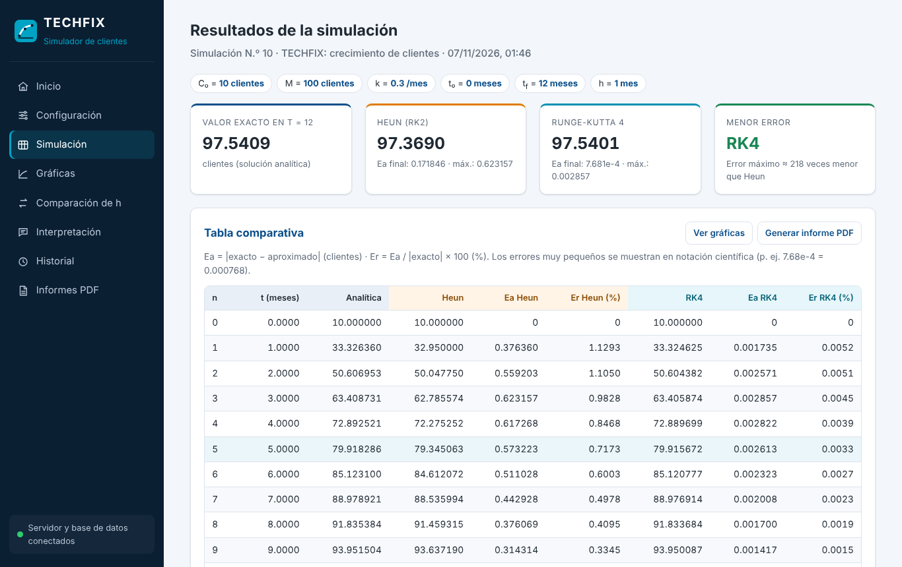

# TECHFIX

**Sistema de simulación del crecimiento de clientes de un emprendimiento de soporte técnico mediante métodos numéricos.**

Proyecto académico de **Métodos Numéricos**. Simula el crecimiento de clientes con la EDO de crecimiento limitado

```
dC/dt = k (M - C),     C(t0) = C0
```

y compara la **solución analítica** `C(t) = M - (M - C0) e^(-k (t - t0))` con los métodos de **Heun (RK2)** y **Runge-Kutta de 4.º orden (RK4)**.

> Los parámetros del proyecto (C0 = 10 clientes, M = 100 clientes, k = 0.3 por mes, 0 a 12 meses) son **hipotéticos**.
> Los resultados son una estimación matemática, no una predicción comprobada.



## Estado del proyecto

| Etapa | Estado |
|---|---|
| 1. Análisis y planificación | ✅ `docs/ETAPA1_PLAN.md` |
| 2. Modelo matemático | ✅ `docs/MODELO.md` |
| 3. Base de datos MySQL | ✅ `docs/BASE_DE_DATOS.md` |
| 4. Backend (Node.js + Express) | ✅ `docs/BACKEND.md` |
| 5. Frontend (HTML, CSS, JS, Chart.js) | ✅ `docs/FRONTEND.md` |
| 6. Pruebas (60 automáticas + Python + navegador) | ✅ `docs/PRUEBAS.md` |
| 7. Publicación | Pendiente |
| 8. Preparación de la defensa | Pendiente |

## Tecnologías

Node.js 22+, Express, MySQL 8 (mysql2), dotenv, PDFKit, HTML/CSS/JavaScript y Chart.js 4 (servido localmente, sin CDN).

## Instalación local (resumen)

1. Instale **Node.js 22 o superior** y **MySQL 8**.
2. Cree la base de datos (ver `docs/BASE_DE_DATOS.md`):
   ```bash
   mysql -u root -p < database/crear_bd_local.sql
   mysql -u root -p techfix < database/schema.sql
   ```
3. Instale las dependencias y configure las variables de entorno:
   ```bash
   npm install
   cp .env.example .env     # complete DB_USER, DB_PASSWORD, etc.
   ```
4. Inicie el servidor:
   ```bash
   npm start
   ```
5. Abra http://localhost:3000

## Comandos útiles

| Comando | Qué hace |
|---|---|
| `npm start` | Inicia el servidor |
| `npm run dev` | Inicia el servidor y lo reinicia al guardar cambios |
| `npm test` | Ejecuta todas las pruebas |
| `npm run test:api` | Solo las pruebas de la API (requiere MySQL) |
| `npm run verificar` | Verificación independiente de los cálculos en Python |
| `npm run test:e2e` | Prueba en navegador real (requiere Playwright, ver `docs/PRUEBAS.md`) |
| `npm run tabla` | Imprime las tablas de h = 1 y h = 0.5 |
| `npm run datos-prueba` | Regenera `database/datos_prueba.sql` desde el código |

## Estructura

```
server/      backend (Express, servicios, módulo numérico)
shared/      validación compartida entre navegador y servidor
public/      frontend
database/    scripts SQL
tests/       pruebas automáticas
scripts/     utilidades (tablas, datos de prueba)
docs/        documentación académica y técnica
```
