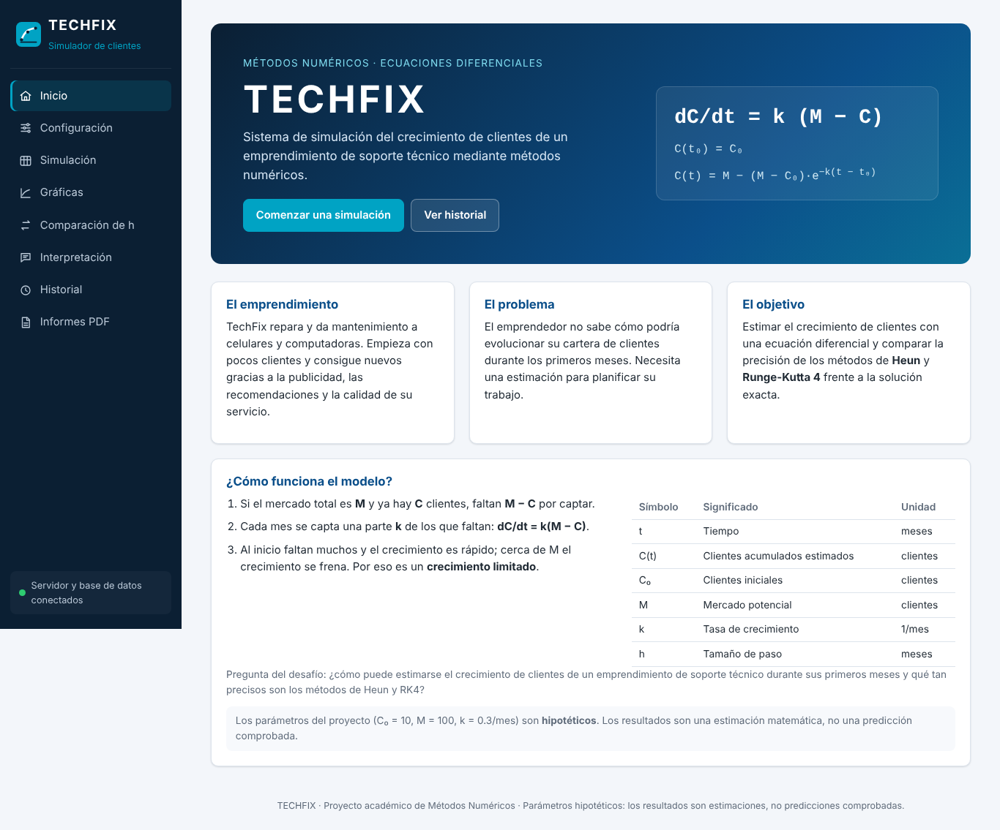
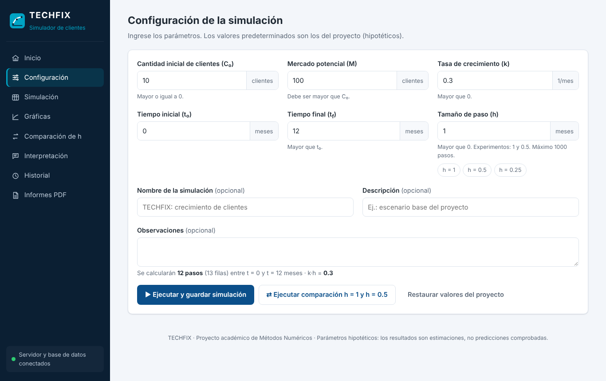
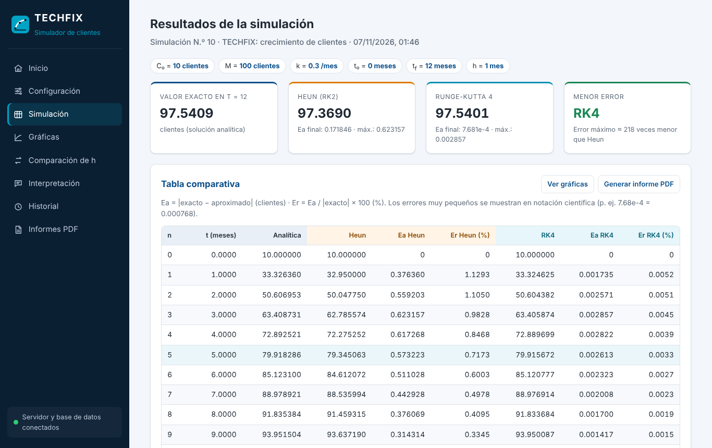
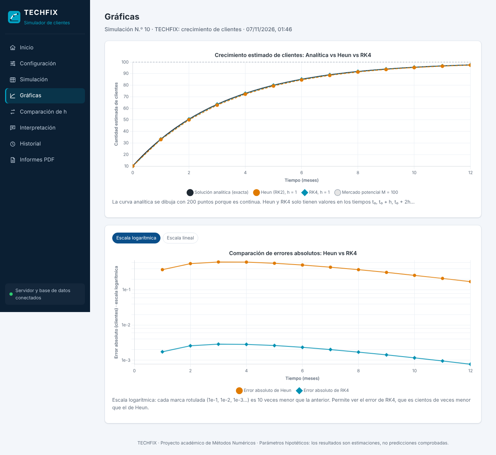
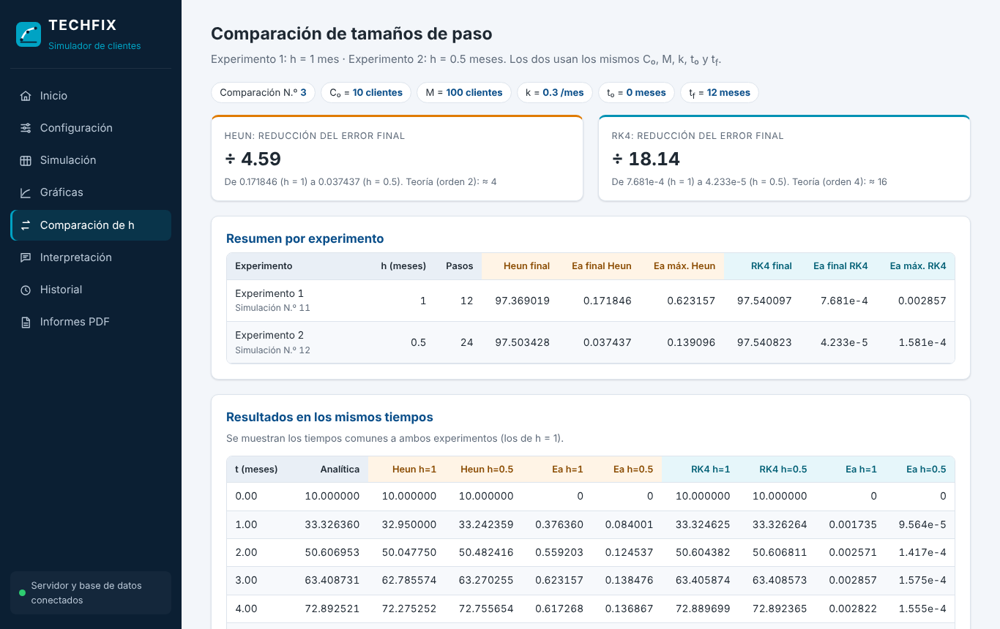
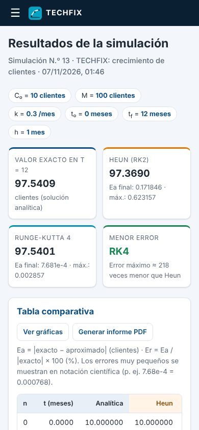

# TECHFIX — Frontend (Etapa 5)

## 1. Idea general

El frontend es una sola página web (HTML + CSS + JavaScript, sin frameworks) dividida en 8 secciones.
Al hacer clic en el menú cambia el `#` de la dirección (por ejemplo `.../#graficas`) y el JavaScript
muestra la sección correspondiente. Así se puede usar el botón "Atrás" del navegador y compartir enlaces a una sección.

**Regla importante:** el navegador **no calcula** ningún método numérico. Envía los parámetros al servidor,
que calcula y guarda en MySQL, y muestra lo que el servidor devuelve. Por eso lo que se ve en pantalla,
lo que se guarda y lo que sale en el PDF son siempre los mismos números.

## 2. Archivos

| Archivo | Para qué sirve |
|---|---|
| `public/index.html` | Estructura de las 8 secciones, el menú y el diálogo de confirmación |
| `public/css/styles.css` | Diseño: colores, tarjetas, tablas, formulario y adaptación a celulares |
| `public/js/formato.js` | Formato de números (6 decimales, notación científica para errores pequeños) y fechas |
| `public/js/api.js` | Todas las peticiones al backend (`fetch`) |
| `public/js/graficas.js` | Las tres gráficas con Chart.js |
| `public/js/app.js` | Navegación, formulario, tablas, historial, informes y confirmaciones |
| `shared/validacion.js` | Validación de entradas, **el mismo archivo que usa el servidor** |
| `/vendor/chart.umd.min.js` | Chart.js 4.6.1, entregado por el propio servidor desde `node_modules` |

**¿Por qué Chart.js se entrega desde el servidor y no desde un CDN?** Si el día de la defensa la red
bloquea el CDN, las gráficas seguirían funcionando.

## 3. Secciones

| Sección | Qué muestra |
|---|---|
| **A. Inicio** | Nombre TECHFIX, emprendimiento, problema, objetivo, ecuación, variables con unidades, aviso de parámetros hipotéticos y botón "Comenzar una simulación" |
| **B. Configuración** | Formulario con C₀, M, k, t₀, tf y h (con unidades y valores del proyecto), validación en vivo, cantidad de pasos y k·h |
| **C. Simulación** | Tarjetas (exacto, Heun, RK4, método con menor error), avisos y tabla con las 9 columnas pedidas |
| **D. Gráficas** | Las tres soluciones en una gráfica, y otra con los errores (escala logarítmica o lineal) |
| **E. Comparación de h** | Experimentos h = 1 y h = 0.5: reducción del error, tablas, gráfica y conclusión |
| **F. Interpretación** | Crecimiento, hitos (50 % y 90 % del mercado), método más preciso, influencia de h, conclusión y limitaciones |
| **G. Historial** | Simulaciones guardadas: parámetros, fecha, resultado final, informes; acciones Abrir / Informe / Eliminar |
| **H. Informes PDF** | Informes registrados: Ver, Descargar, ir a la simulación, Eliminar; botón para generar uno nuevo |

## 4. Validación en el navegador

Se usan las **mismas reglas** que el servidor (`shared/validacion.js`):

- Campos vacíos → "Este campo es obligatorio."
- Texto no numérico (`abc`, `12abc`) → "Debe ser un número válido." (se acepta coma decimal: `0,3`)
- C₀ ≥ 0 · M > C₀ · k > 0 · h > 0 · tf > t₀ · máximo 1000 pasos

Los errores aparecen debajo de cada campo mientras el usuario escribe. Aun así, **el servidor vuelve a validar**,
porque cualquier persona podría enviar datos sin pasar por el formulario.

Los campos usan `type="text"` con `inputmode="decimal"` en lugar de `type="number"`. Con `type="number"`,
el navegador borra en silencio lo que no es número, y el usuario no vería ningún mensaje.

## 5. Gráficas

1. **Soluciones:** la curva analítica se dibuja con 200 puntos que calcula el servidor (es continua);
   Heun (naranja, guiones) y RK4 (turquesa, puntos) solo tienen valores en t₀, t₀ + h, …
   La línea gris punteada es el mercado potencial M.
   Al pasar el mouse por un tiempo, la información emergente muestra **juntos** el valor exacto,
   Heun y RK4 con sus errores en ese instante (modo de interacción propio `nodoTechfix`).
2. **Errores:** en escala **logarítmica** (por defecto), porque el error de RK4 es cientos de veces menor
   que el de Heun y en escala lineal parecería cero. Se puede cambiar a escala lineal con un botón.
3. **Comparación h = 1 vs h = 0.5:** errores de los dos métodos con los dos tamaños de paso.

Los colores son los mismos en tablas, gráficas y PDF: **Heun = naranja**, **RK4 = turquesa**, **analítica = negro**.

## 6. Persistencia

- Todos los datos están en **MySQL**. Cerrar el navegador o reiniciar el servidor no borra nada.
- El navegador solo recuerda el **número** de la última simulación y de la última comparación abiertas
  (`localStorage`), para volver a cargarlas desde MySQL al abrir la página. Si ese almacenamiento
  está bloqueado (modo privado), la aplicación funciona igual.

## 7. Diseño adaptable

- **Computadora:** menú lateral fijo.
- **Tablet y celular (≤ 900 px):** barra superior con botón ☰ que abre el menú.
- Las tablas anchas se desplazan horizontalmente **dentro de su recuadro**; la página nunca se desplaza de lado.

## 8. Seguridad en el navegador

- Los textos que escribe el usuario (nombre, descripción) se **escapan** antes de insertarlos en HTML
  (`Formato.html`), para evitar inyección de código.
- El navegador nunca recibe credenciales de MySQL: solo conoce las rutas `/api/...`.
- Antes de eliminar una simulación o un informe se pide **confirmación** en un diálogo.

## 9. Prueba realizada en un navegador real (Chromium)

Flujo automatizado con Playwright contra el servidor y MySQL 8:

| Paso | Resultado |
|---|---|
| Abrir la página | Indicador "Servidor y base de datos conectados" |
| Enviar C₀ = −5, k = "abc", h vacío | 3 mensajes de error, no se envía nada |
| Restaurar valores y ejecutar | Tabla de 13 filas; última fila: 97.540865 · 97.369019 · 97.540097 |
| Gráficas | Información emergente en t = 3: exacto 63.408731, Heun 62.785574, RK4 63.405874 |
| Comparación | Heun ÷ 4.59, RK4 ÷ 18.14; 13 tiempos comunes |
| Historial | 3 simulaciones (1 individual + 2 experimentos) |
| Generar informe | Informe registrado; PDF descargado (200, application/pdf) |
| Eliminar → Cancelar | No se elimina nada |
| Eliminar → Aceptar | La simulación desaparece del historial |
| Recargar la página | La comparación se vuelve a cargar desde MySQL |
| Celular (390 px) | Menú ☰, simulación y gráficas correctas, sin desplazamiento horizontal |
| Consola del navegador | Sin errores ni advertencias |
